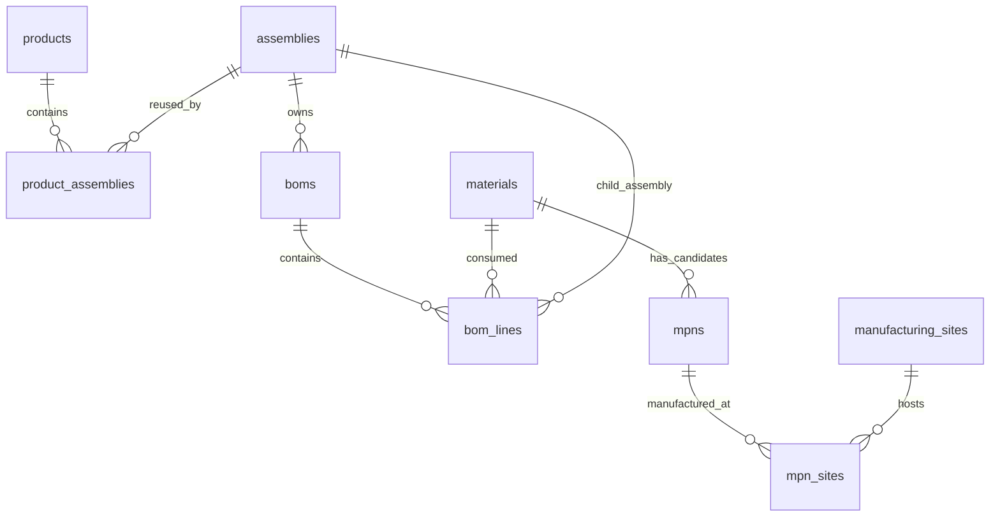

# 芯链 CoreLink · EE Management

企业电子物料、复杂多层 BOM、MRP 用量与制造供应地图平台。React / Vinext、Cloudflare Workers、D1（SQLite）、Drizzle、Leaflet。

- 在线私有站点：<https://ee-management-nld.rickydai861114.chatgpt.site>
- GitHub：<https://github.com/non-linear-dai/EE_Management>

## 企业内部零件号

企业产品、PCBA、TLA 与电子物料均有内部零件号。默认遵循用户给出的 `1234567-00-A` 样式：七位主体数字、两位后段数字、一位大写字母。后两段业务含义未指定，与 BOM 版本保持独立。

「内部编码规则」可按类型配置前缀、主体号位数、主体起始值和后段样式。后段中的 `0` 匹配数字，`A` 匹配大写字母；自动分配使用后段的默认值，手动可输入其他合规后段。留空自动编号，保存时跨产品、总成和物料查重，SQLite 触发器保证并发写入也遵守全局唯一，自动分配遇到冲突会重试。已有历史编号不会自动改写；原编号不变的编辑仍可保存。

内部零件号与制造商 MPN 独立：一颗内部物料对应多个候选 MPN，记录批准状态、生命周期、规格书及验证说明。

## 多层级 BOM

每个 PCBA / TLA 拥有独立生效 BOM，行项目可引用物料或其他总成，支持多个层级和复用子总成。每行记录单级用量、基本单位、损耗加成、参考位号和说明。

- 可折叠树形展开、直接用料视图、零件号 / 名称 / 位号检索、每页 100 行。
- 显示逐路径累计用量，支持指定展开基数；共享行分别展示在每条路径。
- CSV 单次追加最多 2,000 行；支持带引号的逗号、换行，客户端预检与服务端再次校验。
- 按内部零件号匹配已建档对象；未知编号、非法用量和循环引用会整体拒绝。批量写入分组以遵守绑定参数限制，并由 D1 原子 batch 整体提交。
- 服务端预检和数据库递归触发器双重阻止循环 BOM，包含并发写入场景。
- BOM 可导出每一层的父级号、单级与累计用量、路径及位号。

CSV 示例：

```csv
内部零件号,数量,位号,损耗加成%,说明
1234567-00-A,20,"R1, R2",2,电阻行
2345678-00-A,2,,0,子总成
```

损耗采用**加成**定义，而非良率倒数：

`累计用量 = 根需求 × 各级单级用量 × 各级 (1 + 损耗加成 / 100)`

安全边界：树形可展开最多 20,000 条路径，深度最多 100 层；超过时明确报错，不静默截断。MRP 按有向无环图汇总，避免重复路径枚举。

## MRP 用量计算

支持多个产品和总成需求合并计算，包含产品到总成的用量系数。共享子总成先合并需求，再按拓扑顺序展开，各物料最终按内部零件号汇总；使用 BigInt 有理数运算，避免浮点尾差。

- 毛需求含所有层级的损耗加成。
- 可输入本次计算的可用物料库存、在途和安全库存；库存只抵扣一次。
- `净需求 = max(毛需求 + 安全库存 − 可用库存 − 在途, 0)`。
- `pcs` 的净需求在全部汇总后向上取整，其他单位保留六位小数；不同单位不合计。
- 缺少生效 BOM、失效关联或循环结构会停止计算并提示具体问题，不输出缺项的 MRP。
- 支持需求调整自动重算、物料详情反查和 CSV 导出。

此版本是静态用量 / 净需求计算。按所有总成自制展开，不抵扣成品或半成品库存；尚未包含交期、工单、采购批量和按时段排程。库存输入为本次测算数据，不写入库存账。

## 制造与供应地图

按 MPN 管理晶圆制造、封装、测试、封装测试，以及 PCB / 无源器件制造等阶段。每条来源保留工厂、运营方、国家、城市、详细地址、WGS84 经纬度、定位精度、坐标来源、制造来源证据和核验日期。

- Leaflet + OpenStreetMap 交互底图，支持缩放、定位全部、按阶段筛选、工厂与地图联动。
- 同坐标工厂聚合，避免城市级标记重叠后隐藏工厂。
- 内置约 34,000 个主要城市的本地检索；检索不向外部地理编码服务发送工厂地址。
- 选择城市填入城市中心点；人工可填写经纬度或在地图上选点。
- 城市级、厂区级、手动待核验和未定位明确区分。已有工厂没有坐标时保持未定位，不推断厂址。
- 经纬度校验范围与成对填写，并要求说明定位精度与来源。

数据来源及许可：

- 城市中心来自 [GeoNames cities15000](https://download.geonames.org/export/dump/readme.txt)，按 [CC BY 4.0](https://creativecommons.org/licenses/by/4.0/) 提供，附公开归属说明于 `public/data/README.txt`。不是厂区地理事实证明，城市库不保证覆盖全部乡镇或工业园。
- 底图使用 [OpenStreetMap 标准瓦片](https://operations.osmfoundation.org/policies/tiles/)，只按可视区域交互加载，保留浏览器缓存及可见署名，没有离线下载或预取功能。互联网底图不可用时显示提示，坐标和工厂清单仍可查看。
- 未接入公共 Nominatim 地址检索，城市检索在本地坐标库完成。

## 示例与现有数据

新生产数据库默认不写业务示例。可先浏览示例，主动选择「载入示例数据」后才整体保存；有物料、产品或总成时禁止覆盖导入。

当前示例包含 180 颗物料、195 个 MPN、5 个产品、9 个总成。高密度采集主板有 161 行直接用料；工业采集整机包含四层路径。例：100 套示例 X5 系统 × 2 顶层总成 × 3 子系统 × 2 主板 × 4 颗电阻 × 1.01 损耗加成 = 4,848 颗电阻毛需求。

所有示例 MPN 替代关系、厂商和制造地均仅供演示，不代表已完成兼容验证或实际厂区确认。已有线上业务数据通过新增字段迁移保留，不自动替换为新版示例。

## 数据模型



另外存储 `numbering_rules` 和 `audit_logs`。一个 BOM 行只能引用物料或子总成中的一个。用户写入要求登录、校验请求 Origin，并进行服务端输入验证。

## 本地运行与验证

Node.js >= 22.13、npm：

```sh
npm run install:ci
npm run build
# 新数据库按序应用；已应用的 SQL 不要重复执行。
node --import ./scripts/sites-env.mjs ./node_modules/wrangler/bin/wrangler.js d1 execute DB --local --config dist/server/wrangler.json --persist-to .wrangler/state --file drizzle/0000_windy_gabe_jones.sql
node --import ./scripts/sites-env.mjs ./node_modules/wrangler/bin/wrangler.js d1 execute DB --local --config dist/server/wrangler.json --persist-to .wrangler/state --file drizzle/0001_loving_eddie_brock.sql
npm run dev
```

预览默认 <http://localhost:5173>，使用 starter 的本机模拟登录。修改 schema 后运行 `npm run db:generate` 并审阅新增 SQL。生产发布自动应用尚未应用的结构迁移，生产与本地数据库独立。

```sh
npm run typecheck
npm test
npm run build
```

测试覆盖跨层用量累乘、共享 DAG 汇总、库存单次抵扣、损耗、十进制精度、取整、空 BOM / 循环 / 溢出、三段号校验、跨类编号分配、CSV 2,000 行等。额外本地接口验证覆盖并发自动分配、2,000 行 D1 原子导入、非法坐标与无效输入不写数据。

## 权限与范围

Sites 私有访问及平台登录保护线上工作区。所有获准的工作区成员具有相同业务编辑权限；企业部门级 RBAC、SSO、历史 BOM 版本审批及 ERP/PLM 同步尚未实现。当前维护一份生效版本，编辑基本信息不能直接变更版本号。

不要提交 `.env*`、`.sites-runtime/`、`.wrangler/`、`node_modules/`、身份凭证或本地测试数据。
