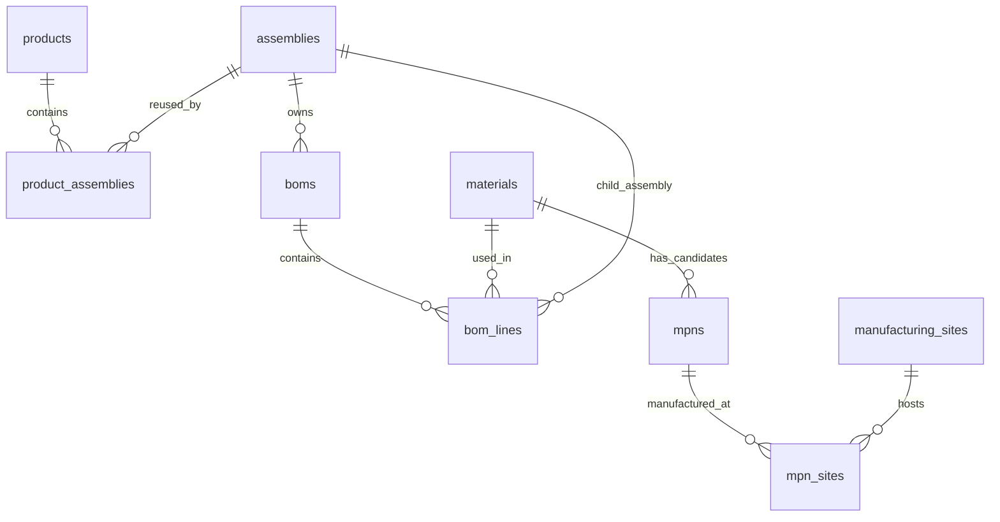

# 芯链 CoreLink · EE Management

企业电子物料管理平台。中文界面，基于 React / Vinext、Cloudflare Workers、D1（SQLite）和 Drizzle。当前 GitHub 仓库：<https://github.com/non-linear-dai/EE_Management>。

## 已实现

- 企业物料唯一内部零件号、分类、封装、生命周期、可编辑特性参数。
- 每颗物料对应多个制造商型号（MPN），独立管理批准状态、生命周期、规格书链接和验证说明。
- 产品与 PCBA / TLA 多对多关联，带用量；每个总成维护独立生效 BOM。
- BOM 行支持企业物料或子总成，含用量、位号、说明，阻止循环总成引用。
- 产品 → 总成 → 物料三级下钻，物料 → MPN → 制造链详情，物料反查含多层间接应用。
- 晶圆制造、封装、测试、封装测试及其他制造阶段；工厂、运营方、国家、城市、来源证据、核验日期。
- 物料 / MPN / 制造商搜索、分类和生命周期筛选、单一批准来源筛选、CSV 导出。
- 在线新增和编辑、关联移除、D1 持久化、变更日志、登录校验、请求来源校验与服务端输入验证。
- 响应式布局、中文使用指南、独立示例浏览模式。

## 数据模型



一个 BOM 行仅能指向物料或子总成中的一个。内部零件号与 MPN 分开管理；制造信息属于 MPN，不能从原厂总部所在地推断实际产地。

## 本地开发

要求 Node.js >= 22.13 与 npm。初次安装：

```sh
npm run install:ci
npm run db:generate # 仅修改 db/schema.ts 后运行，初次迁移已提交
npm run build
node --import ./scripts/sites-env.mjs ./node_modules/wrangler/bin/wrangler.js d1 execute DB --local --config dist/server/wrangler.json --persist-to .wrangler/state --file drizzle/0000_windy_gabe_jones.sql
npm run dev
```

迁移每个本地数据库只执行一次。预览默认 <http://localhost:5173>。本机开发使用 starter 提供的模拟登录；生产登录由 Sites 平台管理。

```sh
npm run typecheck
npm test
npm run build
```

## 示例数据

新数据库默认不写入任何业务数据。页面可先浏览 20 颗示例物料、35 个 MPN、4 个产品、6 个总成及其 BOM。点击「载入示例数据」后才将示例整体保存；工作区已有物料、产品或总成时禁止导入。直接新建真实档案不会自动导入示例。

**示例 MPN 关系并非互换性建议，工厂与制造地为虚构演示信息。** 替代器件须验证电气、封装、软件与可靠性兼容。只有「已批准」且未停产的 MPN 计入可用来源。

## 部署与权限

`.openai/hosting.json` 保存 Sites 标识与 `DB` 绑定。发布时应用 `drizzle/` 内的结构迁移并持久化到 D1，生产与本地数据库相互独立。Sites 使用私有访问，API 要求登录并校验写入请求 Origin。所有获准访问工作区的成员拥有相同业务编辑权限；当前没有企业部门级 RBAC、SSO、BOM 历史审批流或 ERP/PLM 同步。扩大访问范围前应按实际组织授权配置工作区。

当前维护一个生效 BOM 版本，创建时指定版本号；编辑基本信息不允许直接改变版本号。历史版本、变更审批及批次级产地追溯可在后续扩展。

不要提交 `.env*`、`.sites-runtime/`、`.wrangler/`、`node_modules/` 或访问凭据。
